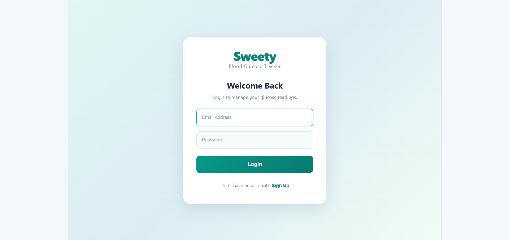
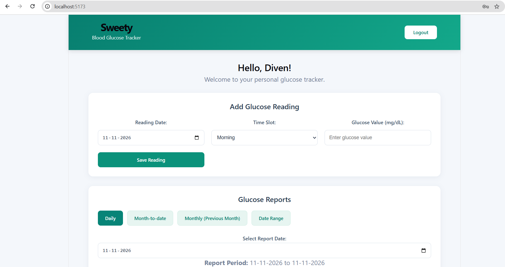
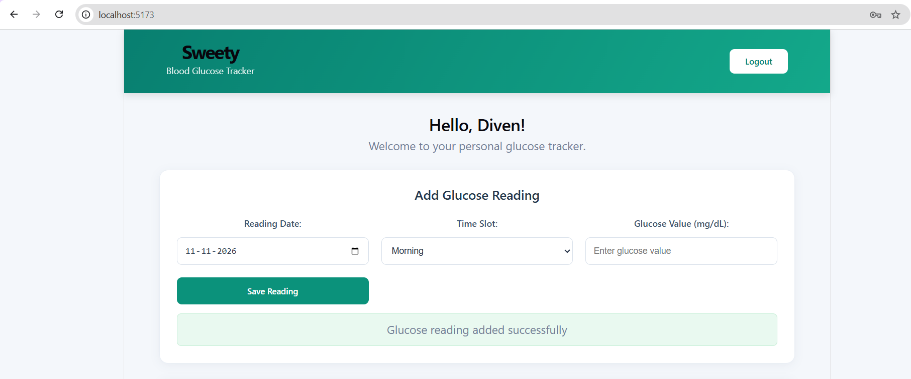
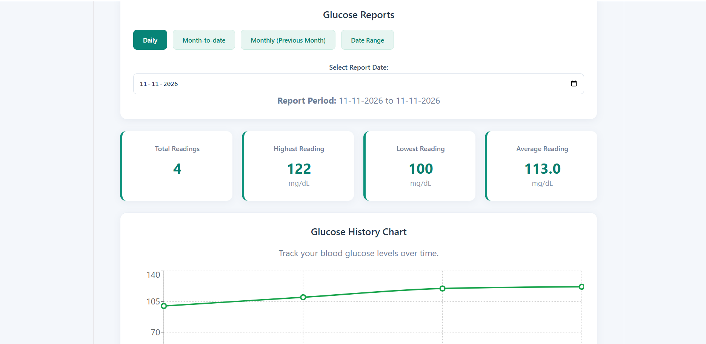
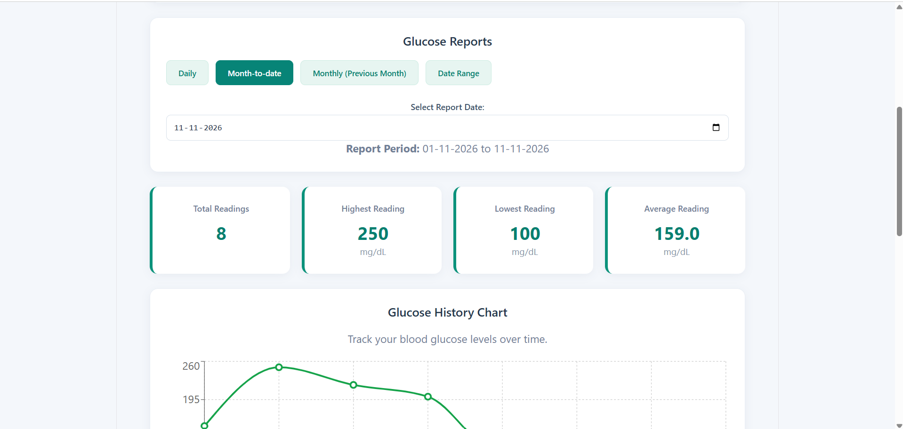
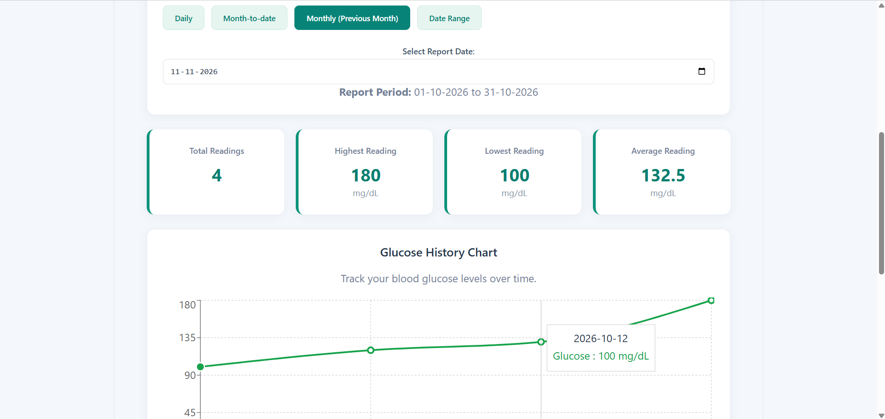
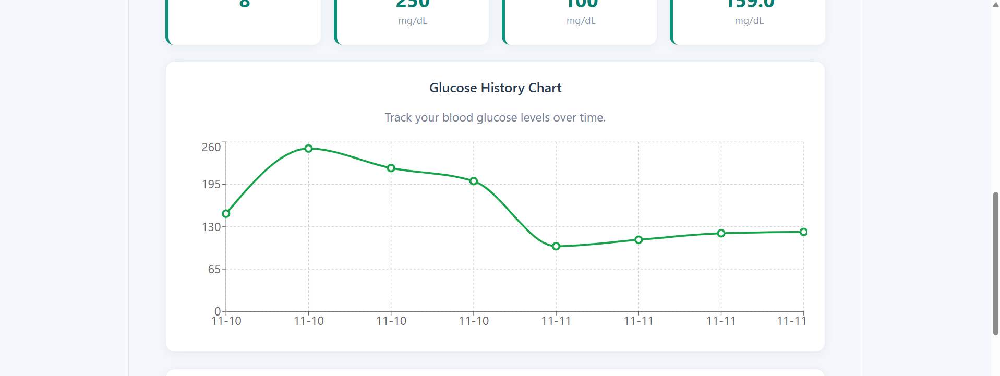
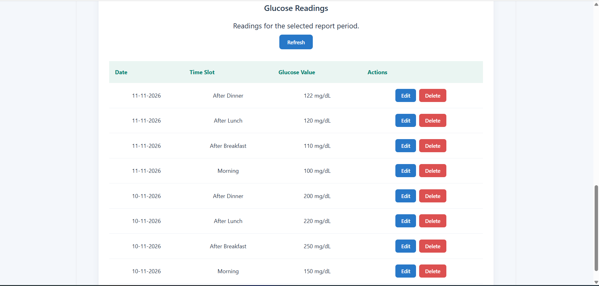

# Sweety – Blood Glucose Tracker

A full-stack web application to record, manage, and monitor daily blood glucose readings.

## Features

- User registration and login
- Secure password hashing using bcrypt
- JWT-based authentication
- Add, view, edit, and delete glucose readings
- Four daily reading slots:
  - Morning
  - After Breakfast
  - After Lunch
  - After Dinner
- Validation for glucose values (40–600 mg/dL)
- Prevent duplicate readings for the same date and time slot
- Daily, Month-to-Date, and Previous Month reports
- Highest, lowest, and average glucose statistics
- User-specific reading management

## Application Screenshots

### 1. User Signup


### 2. User Login


### 3. Dashboard


### 4. Add Glucose Reading


### 5. Daily Report


### 6. Month-to-Date Report


### 7. Previous Month Report


### 8. Glucose History Chart


### 9. Glucose Readings History


## Technology Stack

**Frontend**
- React
- Vite
- JavaScript
- CSS

**Backend**
- Node.js
- Express.js
- PostgreSQL
- bcrypt
- JSON Web Token (JWT)

## Project Structure

```text
sweety-glucose-tracker/
├── client/
│   ├── src/
│   └── package.json
├── server/
│   ├── src/
│   │   ├── config/
│   │   ├── controllers/
│   │   ├── middleware/
│   │   ├── routes/
│   │   ├── app.js
│   │   └── server.js
│   ├── seed.js
│   └── package.json
└── README.md
```

## Installation and Setup

### 1. Clone the repository

```bash
git clone YOUR_GITHUB_REPOSITORY_URL
cd sweety-glucose-tracker
```

### 2. Backend setup

```bash
cd server
npm install
```

Create a `.env` file using `.env.example` and configure your PostgreSQL database credentials and JWT secret.

Start the backend:

```bash
npm run dev
```

### 3. Frontend setup

Open another terminal:

```bash
cd client
npm install
npm run dev
```

Open the application at:

http://localhost:5173/

## Database Seeding

To insert the demo user and sample glucose readings:

```bash
cd server
node seed.js
```

## Demo Login

- **Email:** demo@sweety.com
- **Password:** Sweety@123

## Notes

- The application uses PostgreSQL for data storage.
- Passwords are stored as bcrypt hashes.
- JWT is used for authentication.
- Each user can access their own glucose readings.

## Author

Developed as a Full Stack Developer assignment.


## Project Demo Video

Watch the complete application demonstration:

[Click here to watch Sweety – Blood Glucose Tracker](https://drive.google.com/file/d/1-oWC-aOJ7kye-STol0c2n8LAcYOA_95W/view?usp=sharing)


## Notes

### Assumptions

- Glucose readings are recorded in mg/dL.
- Each user can record a maximum of four readings per day, one for each time slot.
- A glucose reading must be an integer between 40 and 600 mg/dL.
- Future dates are not allowed for glucose entries.
- Each user's readings are private and accessible only after authentication.
- The demo account and sample readings are provided for testing purposes.

### Future Improvements

With more development time, I would improve the application by adding:

- Interactive glucose trend charts using Recharts.
- Pagination and advanced filtering for reading history.
- Password reset and email verification.
- Docker support for easier deployment.
- Automated unit and integration tests.
- Improved mobile responsiveness and accessibility.
- Doctor access to view patient reports with user permission.
- Cloud deployment and production monitoring.